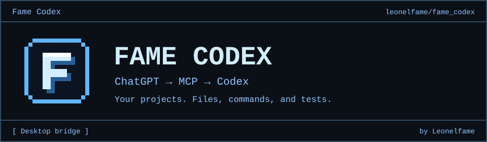
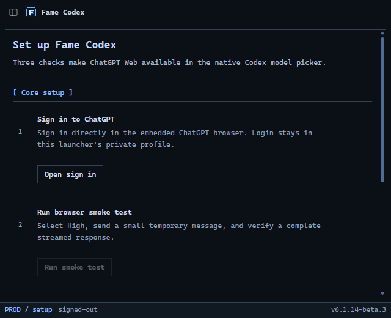

# Fame Codex

<p align="center">
  
</p>

<p align="center">
  <a href="https://github.com/leonelfame/fame_codex/releases">Download Fame Codex</a> ·
  <a href="https://github.com/leonelfame/fame_codex/issues">Report an issue</a> ·
  <a href="https://github.com/leonelfame">Leonelfame</a>
</p>

<p align="center">
  <a href="README.md">English</a> · <a href="README.zh-CN.md">简体中文</a> · <a href="README.ja.md">日本語</a> · <a href="README.ko.md">한국어</a>
</p>

<p align="center">
  <a href="#get-started">Get started</a> · <a href="https://github.com/leonelfame/fame_codex/releases">What’s new</a> · <a href="docs/architecture.md">Architecture</a> · <a href="TROUBLESHOOTING.md">Troubleshooting</a>
</p>

Fame Codex is a desktop app maintained by [Leonelfame](https://github.com/leonelfame). It connects your signed-in ChatGPT browser session to Codex through MCP, so Codex can edit project files and run commands with the tools and approvals for the current task.

The launcher uses a blue Terminal/TUI interface and an 8-bit F icon. Setup, the embedded ChatGPT browser, MCP, Activity, and Settings stay in one window. A separate DEV profile lets you test changes without replacing your normal account session.

Choose a Fame Codex model ending in **(Web)** from Codex's model picker. Available models and usage limits depend on your ChatGPT account.

<p align="center">
  
</p>

The screenshot shows the local development build. Downloadable packages and their supported platforms are listed on the [Releases page](https://github.com/leonelfame/fame_codex/releases).

<div id="get-started"><a id="quick-start"></a></div>

## Get started

Open [Releases](https://github.com/leonelfame/fame_codex/releases) and download an installer attached to a published release. Read its release notes for known issues and platform support. A version in this source tree does not mean its installer has been published.

**Available models:** Free/Go → **Luna / Think**. Paid accounts → **GPT-6 Sol** and **GPT-5.6 Sol**, with **Instant–High**, plus **Extra High** and **Pro** when available. Each version has its own entry; existing GPT-5.6 chats keep GPT-5.6. Availability depends on your account and workspace.

1. **Install the launcher** from the Releases page.
2. **Sign in to ChatGPT** in the embedded browser and run the browser smoke test.
3. **Install models** and restart Codex once. In automatic mode, choose a model ending in **(Web)**. Pro versions have separate entries; Sol reasoning is selected through Effort. Zero Risk keeps its dedicated entry.
4. **For coding with tools**, open **MCP** in the launcher and complete the Full harness setup below.

The app includes its browser and runtime. No separate Chrome, Node, or Bun installation is needed.

<details>
<summary><strong>Terminal install, updates & repair</strong></summary>

Finish active Codex Web turns before quitting the launcher to update. Closing the bridge during a turn interrupts its connection. These installers select the platform and architecture, verify the published checksums, and preserve your ChatGPT profile and launcher settings.

**macOS / Linux**

```bash
curl -fsSL https://github.com/leonelfame/fame_codex/releases/latest/download/install-launcher.sh | sh
```

**Windows PowerShell**

```powershell
irm https://github.com/leonelfame/fame_codex/releases/latest/download/install-launcher.ps1 | iex
```

</details>

<details>
<summary><strong>Models, modes & MCP setup</strong></summary>

<a id="modes"></a>

Automatic modes offer Luna/Think when the account has no reasoning selector; otherwise Instant–High, with Extra High and Pro available independently when exposed by the account.

| Mode | Sending messages | Local Codex tools |
| --- | --- | --- |
| **Browser-only** | Automatic | No |
| **Full harness (With Automation)** | Automatic | Yes, through MCP |
| **Zero Risk** | Paste and send manually | Yes, through a separate MCP connector |

Zero Risk does not read or operate the ChatGPT page. Choose the model and `Fame Codex Zero Risk` connector yourself, paste and send the prepared prompt, then confirm **Sent** in the launcher. Automatic models ending in **(Web)** expose their supported Effort choices in Codex. Instant and each Pro version have separate entries to preserve their context budgets; older saved model entries keep their original fixed mode.

<a id="full-harness"></a>

### Full harness

Full mode connects ChatGPT's tool calls back to the current Codex task through the official
[OpenAI tunnel-client](https://github.com/openai/tunnel-client). The tunnel is outbound: it does
not expose a public IP, open an inbound port, or require router forwarding.

The launcher uses your system proxy for the tunnel. Explicitly configured proxy
environment variables take priority; local connections stay local.

The launcher's **MCP** page guides the complete setup. For the exact clicks, see the
[video walkthroughs](TROUBLESHOOTING.md).

> **Limits**
>
> See [Limits](https://github.com/leonelfame/fame_codex/discussions/309) for the current
> ChatGPT message allowances for **GPT-5.6 Sol Pro** and **GPT-6 Astra**. Context limits depend on
> the account type and selected effort. Plus Medium/High uses a measured 90,000-token window.
> GPT-5.6 supports up to 270,000 tokens with experimental **3× context** enabled, with native
> Codex compaction supported throughout.
>
> GPT-6 Sol supports Bigger Context at Medium, High and available Extra High: **120,000 tokens
> on Plus**, with compaction at **110,000**, and **240,000 on Pro**, with compaction at **220,000**.
> GPT-6 Instant uses standard context.
> GPT-5.6 and GPT-6 Pro keep their existing Bigger Context limits.

1. Finish the required setup, open **MCP**, create the Tunnel and regular API key, then press
   **Connect harness**.
2. Enable ChatGPT **Developer Mode** and create a new Tunnel connector named exactly
   **Fame Codex Native2**, with **Authentication: None** and **Allow all actions**.
3. Run **Verify runtime** to confirm that **Fame Codex Native2** is attached and available.

Write/modify actions also require the ChatGPT workspace and its administrator policy to permit
them. See
[developer mode and MCP apps](https://help.openai.com/en/articles/12584461-developer-mode-and-mcp-apps-in-chatgpt).
Unexpected approval prompts fail closed unless `--auto-approve-tool-calls` is explicitly enabled;
that option clicks **Allow once**, never a permanent grant.

</details>

<details>
<summary><strong>Diagnostics & subagents</strong></summary>

<a id="operations"></a>

Use **Activity** for safe local diagnostics and **Settings → Run doctor** for end-to-end health.
Use **Settings → Updates → Check for updates** to compare your installed version with published GitHub releases. Enable **Include Beta releases** to check prereleases too. **Download update** opens the installer in your browser; it does not close Fame Codex. Finish active Codex tasks before installing.
Settings can also cancel a retained browser turn or remove the Codex integration before uninstall.
**Save chats in ChatGPT** keeps task conversations in ChatGPT history. On by default for new setups;
independent of **New browser chat for each turn**. Existing explicit choices are preserved when
updating. Turn it off to use Temporary Chat, where ChatGPT may not expose your connector.
Set `CODEX_CHATGPT_WEB_BROWSER_DIAGNOSTICS=1` only when every browser checkpoint needs a screenshot.

New installs use **Compatibility V1** for cross-backend subagents. **Native** preserves Codex's own
feature settings and enables plaintext Web-to-Web V2 delegation. Restart Codex and start a new task
after changing the protocol:

```bash
codex-chatgpt-web subagents status
codex-chatgpt-web subagents compatibility-v1
codex-chatgpt-web subagents native
```

</details>

<details>
<summary><strong>Requirements & security</strong></summary>

<a id="limitations-and-security"></a>

- This is unofficial browser automation, not an OpenAI API. ChatGPT UI changes can break selectors;
  drift fails explicitly instead of silently switching model or transport.
- Browser state is a sensitive login artifact, and the loopback listener is reachable by processes
  running as the same local user. Never share the launcher profile; use a trusted workstation.
- Release packages currently target macOS 13+ (arm64/x64), Windows x64, and Linux x64. Runtime,
  tests, and packaging are gated on all three in CI; account-bound browser and MCP flows use the
  separate [release validation](docs/release-validation.md).
- Builds are not yet platform-signed, so Gatekeeper or SmartScreen may warn. The installers verify
  the published SHA-256 manifest before installation.

Read the complete [architecture](docs/architecture.md) and
[security model](docs/security-model.md) before enabling full mode. Report vulnerabilities through
[SECURITY.md](SECURITY.md).

Temporary Chat is a [ChatGPT privacy mode](https://help.openai.com/en/articles/8914046-temporary-chat-faq); prompts are still processed by OpenAI.

Validation coverage: [release validation](docs/release-validation.md).

This is independent software and is not affiliated with or endorsed by OpenAI. Use it only with
your own account and in accordance with applicable [Terms of Use](https://openai.com/policies/terms-of-use/)
and workspace policies; it does not bypass authentication or access controls.

</details>

<details>
<summary><strong>Run from source & develop</strong></summary>

<a id="development"></a>

```bash
git clone https://github.com/leonelfame/fame_codex.git && \
cd fame_codex && \
bun run app
```

This source path requires Bun 1.4.0. The command installs locked dependencies and opens the app.

```bash
bun run app
bun run dev:launcher
bun run src/cli.ts dev status
bun run dev:chat compaction-lab "Reply with exactly: DEV READY"
bun run verify
bun run smoke:subagents
bun run app:package
```

`dev:launcher` uses a separate profile and account under `~/.fame-codex-dev`. `dev:chat` exercises the real browser and compaction paths with explicit simulated tool results, without changing your normal Codex route. See the [DEV chat harness](docs/dev-chat.md) for setup and commands.

</details>

## Maintainer

[Leonelfame](https://github.com/leonelfame) maintains and distributes Fame Codex at [leonelfame/fame_codex](https://github.com/leonelfame/fame_codex).

See the [Fame Codex project notice](FAME_CODEX_NOTICE.md) and [license notices](LICENSES/).

---

[Troubleshooting](TROUBLESHOOTING.md) · [Security](SECURITY.md) · [Project notice](FAME_CODEX_NOTICE.md) · [CI](https://github.com/leonelfame/fame_codex/actions/workflows/ci.yml)
